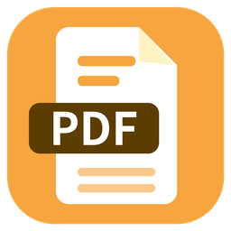

<p align="center"></p>

# 스마트PDF Editor (smartpdfeditor)

PDF를 보면서 **바로 글자를 고치고**, 색칠·감추기·도형·메모·캡쳐까지 할 수 있는 Windows용 PDF 뷰어입니다.
[스마트공(smartgong.kr)](https://smartgong.kr) 업무 도구 시리즈입니다.

## 내려받기

- **바로 받기**: https://smartgong.kr/download/smart-pdf-editor (항상 최신 버전)
- 또는 [**Releases**](https://github.com/nunco-git/smartpdfeditor/releases/latest)에서 `smartpdfeditor.exe` 를 받아 실행하세요. 설치는 필요 없습니다.

> 처음 실행할 때 Windows SmartScreen 경고가 나오면 「추가 정보 → 실행」을 누르세요.

## 주요 기능

| 구분 | 기능 |
|---|---|
| 보기 | 연속 스크롤 · 한 쪽씩 · 2/3/4쪽 나란히, 가로맞춤/세로맞춤, 확대·축소 |
| 모드 | 👁 뷰어 모드(글자 선택·복사) / ✎ 편집 모드 (F4) |
| 편집 | 글자 클릭 → 수정, 찾아 바꾸기, 되돌리기 |
| 도구 | 색칠(24색 색상표) · 감추기(내용 실제 삭제) · 도형(사각형·원·타원·삼각형·선·화살표) · 메모(본문 글상자, 원래 위치와 연결) · 지우개 · 캡쳐(클립보드 복사) |
| 쪽 | 쪽별·여러 쪽·전체 쪽 회전, 원하는 쪽만 골라 새 PDF로 저장 |
| 찾기 | 이 파일에서 찾기(Ctrl+F, F3 다음) · 폴더에서 PDF 찾기(파일명·본문) |
| 파일 | 여러 파일을 탭으로(× 닫기), 프로그램은 하나만 실행, 새 창으로 열기 |
| 정리 | 즐겨찾기 · 북마크(선택한 글자로 바로 추가, 폴더 정리, 여러 개 삭제) · 최근 본 파일 200개 |
| 설정 | 테마(스마트클립 주황·기본·밝게·어둡게), 글꼴·색·배경 그림, 개수 설정, 설정 내보내기/가져오기 |

자세한 사용법은 프로그램의 **사용방법**(F1)을 눌러 보세요.

## 직접 실행 · 빌드

Python 3.10 이상(64비트, 3.12 권장)이 필요합니다.

```bat
pip install -r requirements.txt
python smartpdfeditor.py
```

실행파일은 `smartpdfeditor_build.bat`을 더블클릭하면 같은 폴더에 `smartpdfeditor.exe`가 만들어집니다.

## 배포 (관리자용)

- `v1.0.1`처럼 **v로 시작하는 태그**를 올리면 GitHub Actions가 exe를 만들어 Releases에 자동으로 올립니다.
- 새 버전을 낼 때는 `smartpdfeditor.py`의 `APP_VER`도 같이 올려 주세요.
- 커밋할 때마다 Windows에서 자동 점검(`tests/smoke_test.py`)이 돌고, 만들어진 exe를 Actions 화면의 Artifacts에서 받아볼 수 있습니다.

## 광고 설정 (관리자용)

프로그램은 `https://smartgong.kr/ads/smartpdfeditor.json`을 읽어 사이드바 하단(250×250)에 광고를 보여줍니다.
형식은 [`docs/ad-example.json`](docs/ad-example.json)을 참고하세요.

- `"enabled": false` → 모든 사용자의 광고창 최소화
- `ads` 여러 개(최대 5개) → `interval`초마다 번갈아 표시
- `link` 클릭 시 열 주소, `until` 광고 종료일
- 인터넷이 안 되면 마지막으로 받은 광고를 보여주고, 받은 적이 없으면 광고창을 최소화합니다.

## 사용 통계 · 개인정보

몇 대의 컴퓨터에서 쓰이는지 세기 위해, 프로그램이 **하루 한 번** 아래 두 가지만 보냅니다.

| 보내는 것 | 예 |
|---|---|
| 처음 실행할 때 만든 무작위 번호 (사람·컴퓨터와 연결되지 않음) | `3f9c…e21a` (32자리) |
| 프로그램 버전 | `1.0.2` |

파일 이름·경로·문서 내용·컴퓨터 이름 같은 다른 정보는 보내지 않습니다.
끄려면 **환경설정 → 일반 → 「사용 통계 보내지 않기」** 를 체크하세요. 보내기에 실패해도 프로그램 사용에는 영향이 없습니다.
(관리자용: 데이터는 스마트탐색기와 같은 Firebase의 `apps/smartpdfeditor/` 아래에 따로 쌓입니다.)

## 라이선스

이 프로그램은 [GNU Affero General Public License v3.0](LICENSE)(AGPL-3.0)으로 공개합니다.
누구나 소스를 보고, 고치고, 다시 배포할 수 있으며, 다시 배포할 때에는 같은 라이선스로 소스를 공개해야 합니다.

- PDF 처리: [PyMuPDF](https://github.com/pymupdf/PyMuPDF) / MuPDF — AGPL-3.0, © Artifex Software, Inc.
- 실행파일 제작: [PyInstaller](https://pyinstaller.org) (GPL, 실행파일 예외 조항 적용)
- 화면: Python tkinter (PSF / Tcl·Tk 라이선스)

'스마트공' 이름과 로고는 smartgong.kr의 것입니다. 이 소스를 고쳐서 따로 배포할 때에는 다른 이름과 로고를 사용해 주세요.
