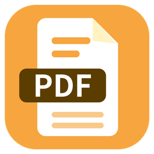

## 스마트PDF Editor — PDF를 보면서 바로 고치는 무료 프로그램

PDF를 열어 **글자를 클릭해서 바로 수정**하고, 색칠·감추기·도형·메모·캡쳐까지 한 프로그램에서 할 수 있습니다.
[스마트공(smartgong.kr)](https://smartgong.kr) 업무 도구 시리즈입니다.

> **무료 프로그램입니다.** 창 오른쪽이나 왼쪽 하단에 광고가 표시될 수 있습니다.
> 설치 없이 실행하는 프로그램이라, 지우려면 **`smartpdfeditor.exe` 파일을 삭제**하면 됩니다. (설정은 `%APPDATA%\smartpdfeditor` 폴더에 있으며 함께 지워도 됩니다)

### 1.0.38 에서 바뀐 점
- 수정 메뉴 → [쪽 전체 글자 목록으로 편집...]: 그 쪽의 모든 줄을 표로 보여 주고, 여러 곳을 고친 뒤 [모두 적용] 한 번으로 반영합니다. ◀ ▶ 로 다른 쪽으로 넘어가며 고쳐도 한꺼번에 적용·되돌리기(Ctrl+Z) 됩니다. 글꼴·크기·색은 원래대로.
- 스캔본 글자 인식: 삐뚤게 스캔된 쪽(±5° 이내)을 자동으로 바로 세운 뒤 인식합니다. (기울어진 스캔은 인식이 거의 안 되던 문제 개선)

### 1.0.37 에서 바뀐 점
- 글자 수정·찾아 바꾸기 때 원래 글꼴을 최대한 유지합니다. PDF에 들어 있는 글꼴을 그대로 쓰고, 없으면 같은 이름의 윈도우 글꼴(맑은 고딕·바탕·굴림·돋움·궁서·Arial 등)을 씁니다. 원래 글꼴에 없는 글자만 기본 한글 글꼴로 대체합니다. 크기·색은 기존처럼 유지.
- 수정 메뉴의 [원래 글꼴 유지해서 수정]으로 끌 수 있습니다.

### 1.0.36 에서 바뀐 점
- 파일 메뉴에 [암호 설정해서 저장...] 추가: 암호(두 번 입력)를 정해 다른 이름으로 저장합니다. 암호를 비우고 저장하면 암호가 없어집니다.

### 1.0.35 에서 바뀐 점
- PDF 병합창: [⛶ 전체 화면] 버튼(또는 F11)으로 화면 가득 키우기, 창 크기도 마음대로 조절.
- 미리보기 크기를 슬라이더·＋/－ 버튼·Ctrl+마우스휠로 자유롭게 조절.
- 병합창 아래쪽에 [🔒 저장 암호]를 넣으면 합친 PDF가 암호(AES-256)로 저장됩니다. (비우면 암호 없음)
- 스캔본 글자 인식: 인식 전에 그림의 대비를 자동 보정(회색 배경 제거·흐린 글자 진하게)하도록 개선.

### 1.0.34 에서 바뀐 점
- [수정]~[캡쳐] 도구 버튼은 아이콘만 표시합니다. (마우스를 올리면 설명)
- [PDF병합]~[이미지 변환] 버튼 글자 크기는 도움말·메뉴와 같은 크기로 키웠습니다.

### 1.0.33 에서 바뀐 점
- [수정]~[이미지 변환] 버튼의 아이콘을 작게(12px), 글자를 조금 작게, 여백을 줄여 세로 높이를 약 70%대로 줄였습니다.

### 1.0.32 에서 바뀐 점
- [수정]~[캡쳐] 도구 버튼과 [PDF병합]~[이미지 변환] 버튼을 아이콘 위·글자 아래로 쌓아 폭을 줄였습니다. 열기·저장·인쇄와 같은 줄에 들어가도록 했습니다.
- 도움말 → [새 버전 확인]: 새 버전이 있으면 바로 자동 업데이트를 권합니다. (없으면 "최신 버전입니다")

### 1.0.31 에서 바뀐 점
- [PDF병합] [용량줄이기] [문서변환] [이미지 변환] 버튼은 창이 좁아져도 항상 글자가 보이고, 옆 버튼 크기의 큰 그림 아이콘이 붙습니다. (그림 변환 → 이미지 변환)
- 새 버전이 나오면 [업데이트 필요] 버튼을 맨 오른쪽에 두어 창이 좁아도 잘리지 않게 하고, 처음 감지했을 때 안내창도 한 번 띄웁니다. (자동 업데이트는 그 창의 [⚡ 자동 업데이트])

### 1.0.30 에서 바뀐 점
- **도구줄이 한 줄에 더 잘 들어갑니다** — 🔗병합 · 📉용량 · 📄문서 · 🖼그림 버튼을 짧은 이름·좁은 크기로 줄였습니다(전에는 버튼마다 넓은 최소 폭이 잡혀 자리를 많이 차지했습니다). 창이 좁으면 이 네 버튼도 그림만 보이고, 마우스를 올리면 전체 이름이 말풍선으로 나옵니다.

### 1.0.29 에서 바뀐 점
- **병합 창에 파일 끌어다 놓기** — 탐색기에서 PDF 파일(여러 개 한꺼번에도 가능)이나 폴더를 병합 창에 끌어다 놓으면 합칠 목록 맨 아래에 추가됩니다. 폴더는 안의 PDF가 이름순으로 들어가고, PDF가 아닌 파일은 건너뛰며 알려줍니다. 암호가 걸린 파일은 암호를 물어봅니다.

### 1.0.28 에서 바뀐 점
- **병합 창을 새로 꾸몄습니다 — 왼쪽은 합칠 파일 목록, 오른쪽은 고른 파일의 쪽 미리보기(작은 그림)** 입니다.
  - 오른쪽에서 쪽을 눌러 고르고(Ctrl·Shift로 여러 쪽) 바로 ⟲ ⟳ 180° 회전, 쪽 앞으로·뒤로, 쪽 빼기를 할 수 있습니다. 회전하면 미리보기 그림도 바로 돌아갑니다.
  - 쪽을 두 번 누르면 크게 볼 수 있고, 미리보기 크기(작게·보통·크게)를 고를 수 있습니다. 쪽이 아주 많아도 보이는 쪽만 그려서 빠릅니다.
  - 파일 추가·같은 파일 한 번 더·순서 바꾸기·가져올 쪽 글로 입력은 왼쪽에 그대로 있습니다.

### 1.0.27 에서 바뀐 점
- **쪽 오른쪽 위에 회전 버튼(⟲ 왼쪽 · ⟳ 오른쪽)** — 평소 PDF를 보는 화면에서 쪽마다 내용 오른쪽 위에 작은 회전 버튼이 보이고, 누르면 그 쪽만 90° 회전합니다. (Ctrl+Z로 되돌리기)
- **암호가 걸린 PDF를 열 수 있습니다** — 열 때 암호를 입력하면(틀리면 3번까지 다시) 보고·고칠 수 있고, 저장하면 같은 암호로 다시 암호가 걸립니다. **병합**할 때도 암호 걸린 파일을 넣으면 암호를 물어봅니다.

### 1.0.26 에서 바뀐 점
- **🔗 PDF 병합(새 기능)** — 도구줄의 **[🔗 병합]**(📉용량줄이기 왼쪽) 또는 [파일 → PDF 병합]으로 여러 PDF를 하나로 합칩니다.
  - **같은 파일도 목록에 여러 번** 넣을 수 있습니다 ([⧉ 같은 파일 한 번 더]). 열려 있는 문서(저장 전 수정 포함)도 [📄 열린 문서 추가]로 넣을 수 있습니다.
  - **파일 순서 조정** — [▲ 위로] [▼ 아래로]
  - **가져올 쪽을 순서 없이 지정** — 예) `3, 1-2, 7-5` (거꾸로 · 같은 쪽 여러 번도 가능, 비우면 전체). 아래 쪽 목록에서 [▲ 쪽 위로] [▼ 쪽 아래로] [✖ 쪽 빼기]로도 고칠 수 있습니다.
  - **쪽별 회전** — 쪽을 골라 ⟲ 왼쪽 90° · ⟳ 오른쪽 90° · 180° (선택한 쪽의 미리보기가 회전된 모습으로 보입니다)
  - 원본 파일은 그대로 두고 새 PDF로 저장합니다.

### 1.0.25 에서 바뀐 점
- **⚡ 자동 업데이트** — [업데이트 필요] 창에서 버튼 한 번으로 새 버전을 받아, 열려 있는 창을 모두 닫고 지금 쓰는 파일 자리에 덮어쓴 뒤 다시 실행합니다. (저장하지 않은 수정은 먼저 저장 여부를 묻습니다)

### 1.0.24 에서 바뀐 점
- **[뷰어] [편집] 버튼 이름이 창이 좁아도 항상 보입니다.**
- **감추기 도구에도 「덮는 색」 펼침메뉴**(검정·회색·흰색)가 도구줄에 나타납니다. 색칠·도형·감추기의 옵션(펼침메뉴)은 모두 📉용량줄이기 왼쪽에 보입니다.
- **용량줄이기·문서변환·그림변환에 「전체 쪽」 체크**가 생겼습니다 (쪽 수를 직접 입력하지 않아도 됨). **용량줄이기도 원하는 쪽만** 골라서 할 수 있습니다 (고른 쪽의 그림만 줄이고 나머지는 그대로).

### 1.0.23 에서 바뀐 점
- **도구줄 바로가기** — 캡쳐 버튼 옆에 **📉 용량줄이기 · 📄 문서변환(워드·엑셀·한글) · 🖼 그림변환** 버튼이 생겼습니다.
- **그림 파일로 변환(새 기능)** — 원하는 쪽을 PNG 또는 JPG 그림으로 저장합니다. 해상도(100~400dpi)를 고를 수 있고, 파일 이름은 `파일이름_001.png` 처럼 쪽 번호가 붙습니다. [파일 → 그림 파일로 변환]에도 있습니다.

### 1.0.22 에서 바뀐 점
- **엑셀 내보내기에서 쪽 사이 빈 줄을 넣을지 고를 수 있습니다** — 내보내기 창의 "쪽 사이에 빈 줄 넣기"를 끄면 모든 쪽이 빈 줄 없이 이어집니다.

### 1.0.21 에서 바뀐 점
- **엑셀로 내보내면 시트 1개** — 모든 쪽의 글과 표가 한 시트에 차례로 들어갑니다. (쪽마다 시트를 나누고 싶으면 내보내기 창에서 체크)
- **한글(.hwpx)에도 그림이 그대로 들어갑니다** — 워드처럼 PDF 안의 그림(스캔한 쪽은 쪽 그림)이 문서에 함께 들어갑니다.

### 1.0.20 에서 바뀐 점
- **PDF 용량 줄이기** — [파일 → PDF 용량 줄이기] 에서 단계(조금/많이/최대)를 고르면 사진·스캔 그림의 해상도를 낮추고 불필요한 데이터를 정리해 새 파일로 저장합니다. 글자는 그대로이고, 줄인 크기를 바로 알려줍니다.
- **워드·엑셀·한글로 내보내기** — [파일 → 워드·엑셀·한글 문서로 내보내기]. 글과 표를 문서로 옮기고(워드는 그림 포함), 엑셀은 쪽마다 시트 1개에 표 칸별로 들어가며 숫자는 숫자로 저장됩니다. 쪽 범위도 고를 수 있습니다. (PDF 특성상 복잡한 서식은 똑같이 재현되지 않을 수 있어요)
- **스캔본 글자 인식(OCR)** — [파일 → 스캔본 글자 인식] 으로 글자 없이 그림만 있는 쪽에 보이지 않는 글자 층을 얹어, **검색·복사가 되는 PDF** 로 저장합니다. 윈도우 기본 글자 인식(한국어 언어 팩 필요) 또는 설치된 Tesseract 를 씁니다. 내보내기에서도 스캔본을 글자로 바꿔줍니다.

### 1.0.19 에서 바뀐 점
- **감추기 색에 회색 추가** — [도구 → 감추기 색]에서 검정 · **회색** · 흰색 중에 고를 수 있습니다. 아래 글자·그림이 지워지고 고른 색으로 덮이는 것은 같습니다.

### 1.0.18 에서 바뀐 점
- **왼쪽 탭 순서 변경** — 즐겨찾기 · 북마크 · 검색 · **최근** 순으로, 최근 탭이 맨 오른쪽으로 옮겨졌습니다.
- **돋보기 칸에 이름 표시** — 즐겨찾기는 "즐겨찾기 검색", 북마크는 "북마크 검색", 최근은 "최근파일 검색"으로 무엇을 찾는 칸인지 바로 보입니다.
- **Ctrl+F = 지금 PDF 파일에서 찾기** — 어느 탭에 있든 Ctrl+F를 누르면 검색 탭이 열리고 "이 파일에서"가 선택된 채 검색어 칸에 커서가 놓입니다. (폴더에서 찾기는 Ctrl+Shift+F)

### 1.0.17 에서 바뀐 점
- **오른쪽 스크롤바가 문서 전체 위치를 보여줍니다** — '한 쪽씩' 보기에서도 20쪽 문서의 1쪽이면 맨 위, 10쪽이면 가운데, 20쪽이면 맨 아래에 스크롤바가 놓입니다. 스크롤바를 끌면 쪽이 넘어가고, 쪽 안에서 내리면 그 쪽 안의 위치도 반영됩니다.

### 1.0.16 에서 바뀐 점
- **켜자마자 오류가 나던 문제 수정** — 새 버전 확인 정보가 저장된 PC에서 시작할 때 `name 'APP_VERSION' is not defined` 오류로 실행되지 않던 문제를 고쳤습니다.

### 1.0.15 에서 바뀐 점
- **배경 사진 9가지** — 호수·숲길·벚꽃·설산·단풍·바다·라벤더·숲·밤하늘 실제 풍경 사진을 [설정 → 환경설정 → 화면 꾸미기]의 '배경 사진 고르기'에서 눌러 바로 고를 수 있습니다. (모두 Wikimedia Commons의 퍼블릭 도메인 사진)

### 1.0.14 에서 바뀐 점
- **테마 10가지** — 따뜻한 베이지·하늘색·초록·분홍·보라·짙은 남색이 추가되었습니다. [설정 → 환경설정 → 화면 꾸미기]의 '빠른 선택' 버튼을 누르면 바로 바뀝니다.
- **배경 그림 빠른 선택** — 하늘·노을·숲·바다·밤하늘·종이 6가지 기본 그림을 눌러 바로 고를 수 있습니다 ([찾아보기]로 내 사진도 가능). 배경 그림은 PDF를 열기 전 화면과 쪽 뒤 빈 곳에 보입니다.

### 1.0.13 에서 바뀐 점
- **회사·기관 인터넷에서도 새 버전 확인·광고가 되도록** — 프록시나 보안 프로그램 때문에 연결이 안 되면 윈도우 인터넷 설정(엣지와 같은 방식)으로 다시 시도합니다.

### 1.0.12 에서 바뀐 점
- **새 버전 알림이 더 빨리** — 프로그램을 켤 때마다 새 버전을 확인합니다 (예전에는 12시간에 한 번). 새 버전이 있으면 위쪽에 [업데이트 필요] 버튼이 나타납니다.

### 1.0.11 에서 바뀐 점
- **바로가기 만들기** — 위쪽 '뷰어' 버튼 왼쪽 **[📌 바로가기]** 에서 바탕화면 바로가기 만들기·작업표시줄 고정 안내. 둘 다 해 두면 버튼은 사라지고, 나중에는 [도움말 → 바로가기 만들기]에서 다시 할 수 있습니다.

### 1.0.10 에서 바뀐 점
- **인쇄 (Ctrl+P)** — 위쪽 [인쇄] 버튼, [파일] 메뉴. Windows 인쇄 창에서 프린터·쪽 범위·매수를 고릅니다. 고친 글자·메모·색칠도 화면에 보이는 그대로 인쇄되고, 가로 쪽은 돌려서 종이에 맞춥니다.

### 1.0.9 에서 바뀐 점
- **북마크를 파일마다 따로** — 북마크 탭에는 지금 보고 있는 PDF의 북마크만 보이고, 다른 파일(탭)을 고르면 그 파일의 북마크로 바뀝니다. 위쪽 '모든 파일'을 체크하면 전체가 보입니다.
- 다른 이름으로 저장하면 그 파일의 북마크도 새 파일로 따라갑니다.

### 1.0.8 에서 바뀐 점
- **새 버전 알림** — 새 버전이 나오면 위쪽 '사용방법' 옆에 **[⬆ 업데이트 필요]** 버튼이 나타납니다. 누르면 바뀐 점을 보고 바로 내려받을 수 있습니다. (12시간에 한 번 깃허브에 최신 버전 번호만 확인)

### 1.0.7 에서 바뀐 점
- 쪽 화면 오른쪽 스크롤 막대(지금 보고 있는 위치)를 **진한 색**으로 바꿔 눈에 잘 띄게 함 (어두운 테마에서는 밝은 색)

### 1.0.6 에서 바뀐 점
- 오류나 개선할 점을 보낼 곳 안내 — 사용방법(F1) 맨 위와 [도움말] 메뉴 맨 아래에 **smartgongmaster@gmail.com** (누르면 주소 복사)

### 1.0.5 에서 바뀐 점
- **저장(Ctrl+S)은 지금 파일에 바로 저장** — 묻지 않고 덮어씁니다. 임시 파일에 다 쓴 뒤 바꿔치기해서 저장 도중 문제가 생겨도 원본이 깨지지 않습니다.
- **「다른 이름으로 저장」 버튼 추가 (Ctrl+Shift+S)** — 원본을 남기고 싶을 때. 저장한 뒤 탭은 새 파일을 가리킵니다.
- **탭이 많을 때 ◀ ▶ 로 넘기기** — 탭이 좁아져 × 가 안 보이던 문제 해결. 탭 위에서 마우스 휠로도 넘기고, ▾ 로 열린 탭 목록에서 바로 고르기
- 쪽이 많은 PDF를 더 빨리 엶 (쪽을 하나씩 열지 않고 크기를 계산, 화면 그림을 압축 없이 바로 표시)

### 1.0.4 에서 바뀐 점
- 사용방법(F1) 맨 처음에 **「PDF 연결하기」** 추가 — PDF를 더블클릭하면 스마트PDF Editor로 열리게 연결하는 방법 (Windows 10·11)

### 1.0.3 에서 바뀐 점 — 한글 입력이 자연스럽게
- **원인:** 한글은 ㅎ→하→한처럼 글자를 조합하는 동안 Windows가 작은 입력 창을 따로 띄워 보여줍니다.
  이 창이 Windows 기본 글꼴로 나와서, 조합 중인 글자가 잠깐 크게 보였다가 완성되면 입력칸으로 옮겨졌습니다.
  그래서 입력이 늦게 느껴지고 글자가 잠깐 크게 보였습니다.
- **고친 내용:** 입력칸에 커서가 가면 조합 창이 입력칸과 **같은 글꼴·같은 크기**를 쓰도록 맞췄습니다.
  이제 조합 중인 글자도 입력칸과 같은 모양으로, 입력하는 바로 그 자리에 보입니다.
- **적용되는 곳:** 글자 수정, 북마크 이름, 검색칸, 설정 등 모든 입력칸
- 그래도 조합 중인 글자가 따로 떠 보이면 [smartgong.kr](https://smartgong.kr)이나 GitHub Issues로 알려 주세요.

### 1.0.2 에서 바뀐 점
- 설치 수 통계 추가 — 하루 한 번 **무작위 번호와 프로그램 버전만** 보냅니다 (파일 이름·내용·개인정보는 보내지 않음)
- 끄려면: **환경설정 → 일반 → 「사용 통계 보내지 않기」** 체크 · 내용은 [도움말 → 정보]에도 적혀 있습니다

### 1.0.1 에서 바뀐 점
- 창 제목줄 왼쪽 위에도 스마트PDF Editor 아이콘이 보이도록 고침 (1.0.0은 Windows 기본 모양으로 보였음)
- 즐겨찾기·북마크·최근 목록 위에 🔍 검색칸 추가 — 이름·경로·쪽 번호·날짜로 바로 걸러 보기 (여러 낱말, Esc 지우기)

### 내려받기 · 실행
1. 아래 **Assets**에서 **`smartpdfeditor.exe`** 를 내려받습니다. (설치 필요 없음)
2. 원하는 폴더에 두고 더블클릭해서 실행합니다.
3. PDF를 늘 이 프로그램으로 열려면: PDF 파일 우클릭 → **연결 프로그램 → 다른 앱 선택** → *스마트PDF Editor* → '항상 사용'

> **처음 실행할 때** Windows SmartScreen 경고가 나오면 **「추가 정보 → 실행」** 을 누르세요.
> 기관·회사 PC는 보안 프로그램이 실행을 막을 수 있습니다. 이때는 전산 담당자에게 허용을 요청하세요.

### 주요 기능
| 구분 | 할 수 있는 일 |
|---|---|
| 보기 | 연속 스크롤 · 한 쪽씩 · 2/3/4쪽 나란히, 가로맞춤/세로맞춤, 확대·축소 |
| 모드 | 👁 **뷰어 모드**(글자 선택·복사) / ✎ **편집 모드** — F4로 전환 |
| 글자 수정 | 글자를 클릭 → 새 글자 입력 → Enter, 찾아 바꾸기 |
| 도구 | 🖍 색칠(24색) · ■ 감추기(개인정보 실제 삭제) · ◻ 도형(사각형·원·타원·삼각형·선·화살표) · 💬 메모(본문 글상자, 원래 위치와 연결) · ⌫ 지우개 · ✂ 캡쳐(클립보드 복사) |
| 쪽 | 쪽별·여러 쪽·전체 쪽 회전, 원하는 쪽만 골라 새 PDF로 저장 |
| 찾기 | 이 파일에서 찾기(Ctrl+F · F3), 폴더에서 PDF 찾기(파일명·본문) |
| 파일 | 여러 파일을 탭으로, 프로그램은 하나만 실행, 새 창으로 열기 |
| 정리 | 즐겨찾기 · 북마크(선택한 글자로 바로 추가) · 최근 본 파일 200개 |
| 꾸미기 | 테마(스마트클립 주황 · 기본 · 밝게 · 어둡게), 글꼴 · 색 · 배경 그림 |

자세한 사용법은 프로그램에서 **F1(사용방법)** 을 누르세요.

### 알아두기
- 저장(Ctrl+S)하면 `원본이름_수정.pdf` 로 따로 저장되어 **원본은 그대로** 남습니다.
- 스캔한(그림으로 된) PDF는 글자 정보가 없어 글자 수정·찾기가 되지 않습니다.
- 즐겨찾기·북마크·설정은 `%APPDATA%\smartpdfeditor` 에 자동 저장됩니다. ([설정 → 설정 내보내기]로 다른 PC에 옮기기)
- 새 버전은 프로그램의 **[도움말 → 새 버전 내려받기]** 또는 https://smartgong.kr/download/smart-pdf-editor 에서 받을 수 있습니다.

### 라이선스
이 프로그램은 **AGPL-3.0** 오픈소스입니다. 이 릴리스의 소스 코드는 아래 *Source code* 에 함께 들어 있습니다.
PDF 처리에 [PyMuPDF](https://github.com/pymupdf/PyMuPDF) / MuPDF (AGPL-3.0, © Artifex Software, Inc.)를 사용합니다.
