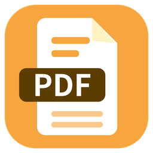

## 스마트PDF Editor — PDF를 보면서 바로 고치는 무료 프로그램

PDF를 열어 **글자를 클릭해서 바로 수정**하고, 색칠·감추기·도형·메모·캡쳐까지 한 프로그램에서 할 수 있습니다.
[스마트공(smartgong.kr)](https://smartgong.kr) 업무 도구 시리즈입니다.

### 1.0.2 에서 바뀐 점
- 설치 수 통계 추가 — 하루 한 번 **무작위 번호와 프로그램 버전만** 보냅니다 (파일 이름·내용·개인정보는 보내지 않음)
- 끄려면: **환경설정 → 일반 → 「사용 통계 보내지 않기」** 체크 · 내용은 [도움말 → 정보]에도 적혀 있습니다

### 1.0.1 에서 바뀐 점
- 창 제목줄 왼쪽 위에도 스마트PDF Editor 아이콘이 보이도록 고침 (1.0.0은 Windows 기본 모양으로 보였음)
- 즐겨찾기·북마크·최근 목록 위에 🔍 검색칸 추가 — 이름·경로·쪽 번호·날짜로 바로 걸러 보기 (여러 낱말, Esc 지우기)

### 내려받기 · 실행
1. 아래 **Assets**에서 **`smartpdfeditor.exe`** 를 내려받습니다. (설치 필요 없음)
2. 원하는 폴더에 두고 더블클릭해서 실행합니다.
3. PDF를 늘 이 프로그램으로 열려면: PDF 파일 우클릭 → **연결 프로그램 → 다른 앱 선택** → *스마트PDF Editor* → '항상 사용'

> **처음 실행할 때** Windows SmartScreen 경고가 나오면 **「추가 정보 → 실행」** 을 누르세요.
> 기관·회사 PC는 보안 프로그램이 실행을 막을 수 있습니다. 이때는 전산 담당자에게 허용을 요청하세요.

### 주요 기능
| 구분 | 할 수 있는 일 |
|---|---|
| 보기 | 연속 스크롤 · 한 쪽씩 · 2/3/4쪽 나란히, 가로맞춤/세로맞춤, 확대·축소 |
| 모드 | 👁 **뷰어 모드**(글자 선택·복사) / ✎ **편집 모드** — F4로 전환 |
| 글자 수정 | 글자를 클릭 → 새 글자 입력 → Enter, 찾아 바꾸기 |
| 도구 | 🖍 색칠(24색) · ■ 감추기(개인정보 실제 삭제) · ◻ 도형(사각형·원·타원·삼각형·선·화살표) · 💬 메모(본문 글상자, 원래 위치와 연결) · ⌫ 지우개 · ✂ 캡쳐(클립보드 복사) |
| 쪽 | 쪽별·여러 쪽·전체 쪽 회전, 원하는 쪽만 골라 새 PDF로 저장 |
| 찾기 | 이 파일에서 찾기(Ctrl+F · F3), 폴더에서 PDF 찾기(파일명·본문) |
| 파일 | 여러 파일을 탭으로, 프로그램은 하나만 실행, 새 창으로 열기 |
| 정리 | 즐겨찾기 · 북마크(선택한 글자로 바로 추가) · 최근 본 파일 200개 |
| 꾸미기 | 테마(스마트클립 주황 · 기본 · 밝게 · 어둡게), 글꼴 · 색 · 배경 그림 |

자세한 사용법은 프로그램에서 **F1(사용방법)** 을 누르세요.

### 알아두기
- 저장(Ctrl+S)하면 `원본이름_수정.pdf` 로 따로 저장되어 **원본은 그대로** 남습니다.
- 스캔한(그림으로 된) PDF는 글자 정보가 없어 글자 수정·찾기가 되지 않습니다.
- 즐겨찾기·북마크·설정은 `%APPDATA%\smartpdfeditor` 에 자동 저장됩니다. ([설정 → 설정 내보내기]로 다른 PC에 옮기기)
- 새 버전은 프로그램의 **[도움말 → 새 버전 내려받기]** 또는 https://smartgong.kr/download/smart-pdf-editor 에서 받을 수 있습니다.

### 라이선스
이 프로그램은 **AGPL-3.0** 오픈소스입니다. 이 릴리스의 소스 코드는 아래 *Source code* 에 함께 들어 있습니다.
PDF 처리에 [PyMuPDF](https://github.com/pymupdf/PyMuPDF) / MuPDF (AGPL-3.0, © Artifex Software, Inc.)를 사용합니다.
